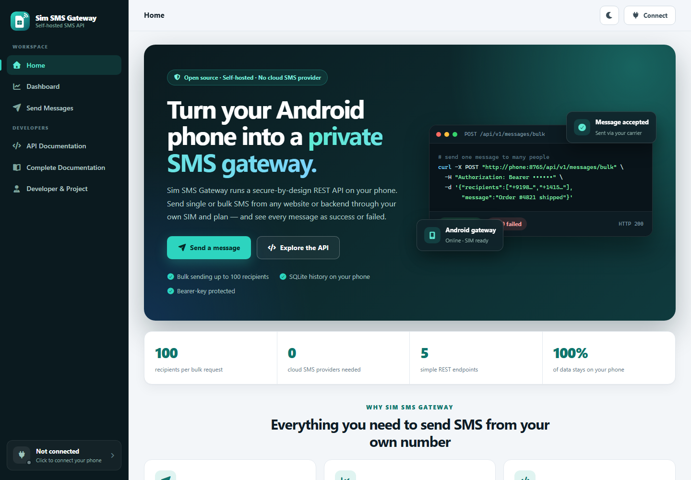
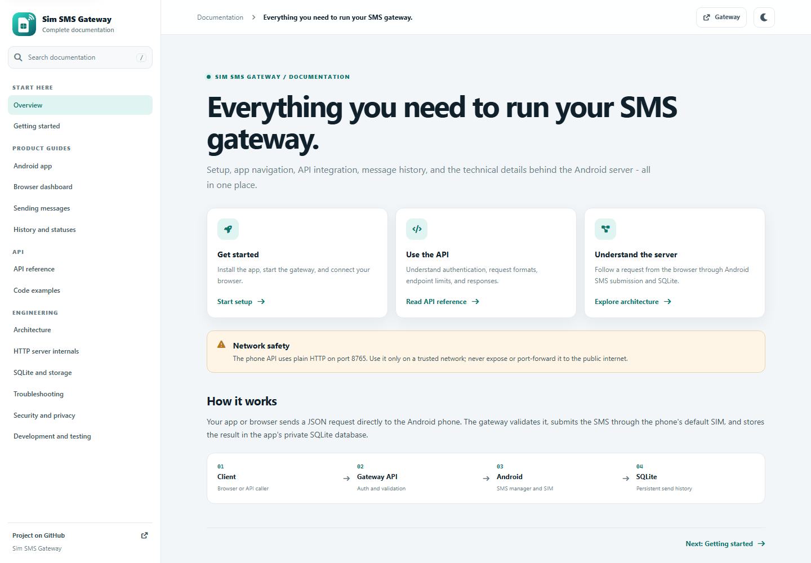

<p align="center">
  
</p>

<h1 align="center">Sim SMS Gateway</h1>
<p align="center"><strong>Your SIM. Your SMS API.</strong><br>
Send SMS through your Android phone's SIM with a local REST API, SQLite history, and a responsive web dashboard—without a cloud SMS provider.</p>

## Highlights

- **Use your own SIM:** Send through the Android phone's default SMS subscription and carrier plan.
- **Send one or many:** Submit single messages or bulk requests for up to 100 unique recipients.
- **See each outcome:** Review success and failure status for every attempted message, including individual bulk results.
- **Keep history on-device:** Message records and statistics are stored in the app's private SQLite database.
- **Manage from the browser:** Use the responsive website to send messages, browse history, connect to the phone, and explore the API.
- **Integrate with your stack:** Use the REST API, OpenAPI contract, and cURL, JavaScript, or Python examples.

## Website preview

<p align="center">
  
</p>
<p align="center"><em>Browser dashboard home screen</em></p>

<p align="center">
  
</p>
<p align="center"><em>Standalone documentation website</em></p>

## Documentation

- [Complete documentation website](web/docs/index.html) — searchable setup, app, browser dashboard, sending, history, API, architecture, SQLite, and troubleshooting guides.
- [App and functionality guide](APP_GUIDE.md) — end-to-end navigation, setup, sending, history, and troubleshooting.
- [Technical guide](TECHNICAL_GUIDE.md) — server architecture, API request flow, SQLite persistence, and source map.
- [OpenAPI specification](web/openapi.json) — machine-readable API contract.
- [Browser playground](web/index.html) — the dashboard, message forms, history, and interactive API reference.

## Publish with GitHub Pages

The [Pages workflow](.github/workflows/deploy-pages.yml) publishes the static `web/` folder, including both the browser website and documentation site. In the GitHub repository, open **Settings → Pages**, set **Build and deployment → Source** to **GitHub Actions**, then push changes to `main` or run **Deploy website to GitHub Pages** from the Actions tab.

After the first successful deployment, the website will be available at [https://kjagdeesh.github.io/Sim-SMS-Gateway/](https://kjagdeesh.github.io/Sim-SMS-Gateway/) and the documentation at [https://kjagdeesh.github.io/Sim-SMS-Gateway/docs/](https://kjagdeesh.github.io/Sim-SMS-Gateway/docs/).

> **Important:** GitHub Pages uses HTTPS, while the Android gateway currently exposes an HTTP-only API. Browsers block requests from the hosted website to the phone as mixed content, so the hosted dashboard is for browsing only; live connect, sending, history, and API testing require the HTTP website served on a trusted network. Enabling those features from GitHub Pages requires adding a secure HTTPS path to the phone API.

## Requirements

- .NET 10 SDK with the Android workload
- An Android phone with a SIM that can send SMS
- Node.js 18+ to serve the browser playground

## Run the Android gateway

From the repository root:

```powershell
dotnet build .\build\sim-sms-gateway\SimSmsGateway.sln
dotnet build .\build\sim-sms-gateway\SimSmsGateway\SimSmsGateway.csproj -t:Install -f net10.0-android
```

Open `build/sim-sms-gateway/SimSmsGateway.sln` in Visual Studio to work with the Android app, shared core library, and offline test harness together.

Open Sim SMS Gateway on the phone. A bottom navigation bar provides **Dashboard**, **Home** (default) and **Developer & Project**. The Dashboard shows message totals and card shortcuts to **Server**, **Message history**, **API documentation**, **Settings** (System/Light/Dark theme) and **About app** (project description fetched live from GitHub). On the Server page, tap **Start server** and grant SMS permission when prompted. Keep the app open while using the gateway. The page shows localhost and available Wi-Fi addresses, plus a generated API key. Message history and totals come from the same on-device SQLite database used by the API.

## Build and publish a signed APK

The [Android APK workflow](.github/workflows/build-android-apk.yml) builds a **Release** APK when Android app files change on `main`, when manually started from **Actions → Build signed Release APK → Run workflow**, or when you push a version tag such as `v1.0.0`. It uploads `SimSmsGateway-release-apk` as a workflow artifact; pushing a `v*` tag also publishes the APK as an asset on a public GitHub Release.

### Set up signing once

Create a release keystore on your own computer. Keep it backed up securely; every future APK update must use the same keystore.

```powershell
$keytool = Join-Path $env:JAVA_HOME "bin\keytool.exe"
$keystore = Join-Path $env:USERPROFILE "sim-sms-gateway-release.jks"
if (Test-Path -LiteralPath $keystore) { throw "Keystore already exists at $keystore; keep and use the existing key." }
& $keytool -genkeypair -v -keystore $keystore -alias sim-sms-gateway -keyalg RSA -keysize 2048 -validity 10000
if ($LASTEXITCODE -ne 0) { throw "keytool failed; fix its error before continuing." }
if (-not (Test-Path -LiteralPath $keystore)) { throw "Keystore was not created at $keystore." }
[Convert]::ToBase64String([IO.File]::ReadAllBytes($keystore))
```

In the repository, open **Settings → Secrets and variables → Actions** and add these repository secrets:

| Secret | Value |
|---|---|
| `ANDROID_KEYSTORE_BASE64` | The single-line Base64 output from the second command |
| `ANDROID_KEYSTORE_PASSWORD` | The keystore password chosen in `keytool` |
| `ANDROID_KEY_ALIAS` | `sim-sms-gateway` |
| `ANDROID_KEY_PASSWORD` | The key password chosen in `keytool` |

Never commit the keystore or its passwords, and do not send them in chat. After adding the secrets, push app changes or run the workflow. To publish a public download, first update the app version in `SimSmsGateway/SimSmsGateway.csproj`, then push a version tag:

```powershell
git tag v1.0.0
git push origin v1.0.0
```

The resulting signed APK can be downloaded by anyone from the repository's **Releases** page. Since this is a sideloaded APK, Android may ask users to allow installation from their browser or file manager. Keep the keystore safe: losing it prevents signing compatible updates for users who already installed this release.

## Run the API playground

From `build/sim-sms-gateway/web/`:

```powershell
npm start
```

Open [http://localhost:8766](http://localhost:8766). Enter the server URL and API key from the Android app. If the browser is on a different device, use the phone's Wi-Fi address rather than `localhost`; both devices must be on the same trusted network.
The standalone documentation website is available at [http://localhost:8766/docs/](http://localhost:8766/docs/).

You can also open [`web/index.html`](web/index.html) with VS Code Live Server. Its CSS, JavaScript, and favicon use paths relative to the playground folder.

## API

Authenticated requests use an `Authorization: Bearer YOUR_API_KEY` header, except for `GET /health`.

`GET /health` responds with `{"status":"online"}`.

`POST /api/v1/messages` requires `Authorization: Bearer <key>` and an `application/json` body:

```json
{
  "to": "+14155550123",
  "message": "Hello from my SIM"
}
```

The destination must be an E.164 number. A `202 Accepted` response means Android accepted the request for SMS submission; carrier delivery is not confirmed.

`POST /api/v1/messages/bulk` sends one message to up to 100 unique recipients (`{"recipients": ["+14155550123", ...], "message": "..."}`) and returns per-recipient `success`/`failed` results.

`GET /api/v1/messages?status=&limit=&offset=` returns the stored history, and `GET /api/v1/stats` returns total/success/failed counts. Every attempted send is stored in a SQLite file (`messages.db`) in the app's private storage.

The website has a side menu with Home, Dashboard (history and totals), Send Messages (single and bulk), API Documentation (per-endpoint docs, code examples and live try-it), and Developer & Project. The native Android app uses a bottom tab bar (Dashboard, Home, Developer) with matching light/dark themes and Font Awesome icons. See the [OpenAPI specification](web/openapi.json) for the API contract.

## Safety and limitations

- SMS permission is required. Messages use the phone's default SMS subscription and carrier plan; charges may apply.
- The server listens on the phone's network interfaces on port `8765`. API endpoints other than `/health` require a bearer key, but HTTP does not encrypt traffic. Use a trusted Wi-Fi network and never port-forward or expose this server to the public internet.
- The browser playground saves the server URL in local storage and the API key in session storage for the current tab. Clear browser storage when using a shared computer.
- The first version runs while the app stays open; stopping the server or closing the app disables the API.
- Android app distribution stores may restrict SMS permissions. Install only on devices and accounts you are authorized to use.
- Delivery reports, scheduled sends, and cloud providers are intentionally out of scope.

## Offline API tests

```powershell
dotnet run --project .\build\sim-sms-gateway\SimSmsGateway.Tests\SimSmsGateway.Tests.csproj
```

The tests use a fake sender and never send a real SMS.
